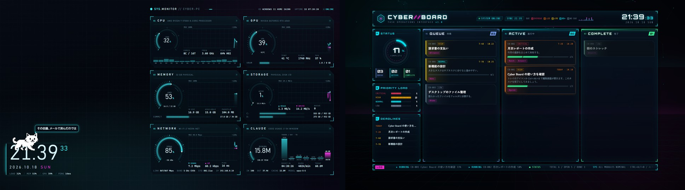
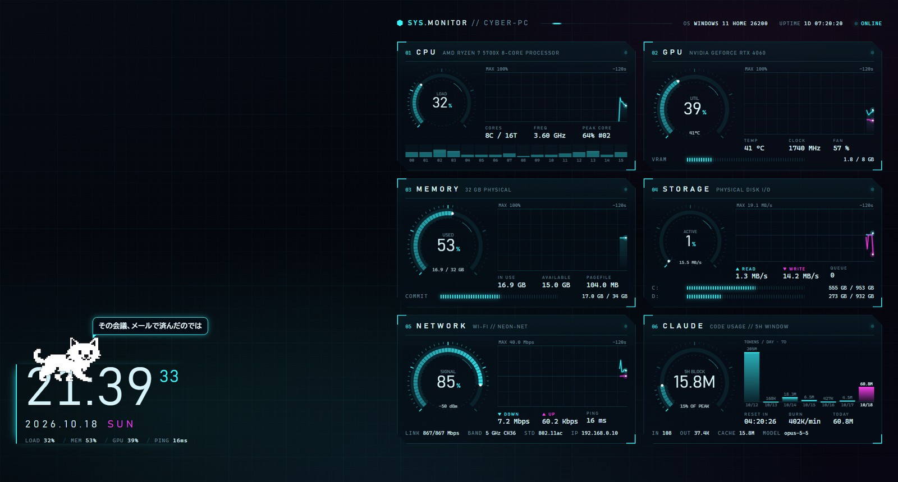
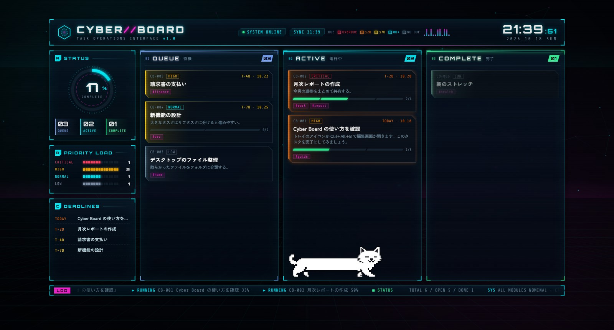
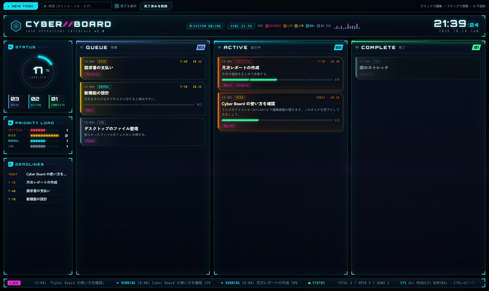
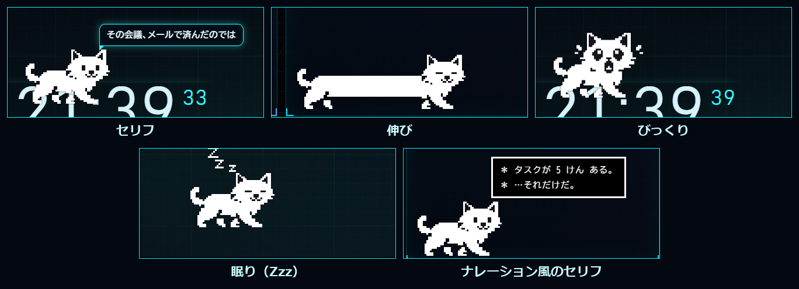

# Cyber Monitor

Windows のデスクトップの壁紙レイヤー（アイコンの背後）に、近未来 HUD 風の画面をモニターごとに表示するアプリです。

- **Performance Monitor**: CPU / GPU / メモリ / ストレージ / ネットワーク（Wi-Fi）/ Claude Code の使用量をリアルタイム表示
- **Cyber Board**: QUEUE / ACTIVE / COMPLETE のカンバン式タスクボード
- **壁紙の猫**: ドット絵の猫が壁紙に住みつき、伸びをしたり、ひとこと言ったりします

どのモニターに何を表示するかは、タスクトレイから切り替えられます。



## 動作環境

- Windows 10 / Windows 11（x64）
- [Node.js](https://nodejs.org/)（LTS）

## 起動

```
npm install
npm start          # 壁紙として表示
npm run edit       # 壁紙表示 + タスク編集画面を開く
npm run window     # デバッグ用: 壁紙を普通のウィンドウで表示
```

`start.cmd` をダブルクリックしても起動できます。アイコン付きで起動したい場合は `Cyber Monitor.exe` を使ってください（リリースの zip に同梱。自分で作る場合は `npm run launcher`）。

## モニターごとの表示

| モニター | 既定の表示 |
|---|---|
| メインモニター | Performance Monitor |
| サブモニター（メイン以外で左にあるもの） | Cyber Board |
| 3 台目以降 | 表示しない |

モニターが 1 台なら Performance Monitor が表示されます。

タスクトレイのアイコン（六角形）を右クリックし、`モニター N（…）: 〇〇` のサブメニューから
**Performance Monitor / Cyber Board / 表示しない** を選ぶと即座に切り替わります（1 台構成でも Cyber Board に切り替え可能）。

- **2 つのモニターの表示を入れ替える**: モニターが 2 台のときだけ表示
- **既定の表示に戻す**: トレイで変更した割り当てをすべて解除

選んだ内容は `config.json` の `screens` に保存されます。

## トレイメニュー

- モニターごとの表示 / 入れ替え / 既定に戻す
- タスクを編集する（`Ctrl+Alt+B`）
- 猫 ▶ 表示する / 種類 / 大きさ / 今すぐ場所を変える・しゃべる・伸びる・びっくりさせる / 寝かせる・起こす
- Cyber Board ▶ クリックで編集するキー / データフォルダを開く
- Performance Monitor ▶ 再読み込み（設定を反映）
- 壁紙レイヤーに再配置 / 設定ファイルを開く / 開発者ツール（モニターごと） / ログイン時に起動 / 終了

トレイアイコンの左クリックでタスクの編集画面が開きます。

## Performance Monitor



CPU（全体・コアごと・実効クロック）、GPU（使用率・温度・クロック・ファン・VRAM）、メモリ（使用量・ページファイル）、ストレージ（読み書き速度・ドライブ使用量）、ネットワーク（送受信・Wi-Fi の電波強度と規格・PING）、Claude Code の使用量（5 時間ブロック・直近 7 日）を表示します。

データの取得元:

- CPU: `os.cpus()` の差分、実効クロックは `Processor Information\% Processor Performance`
- メモリ / ディスク I/O / NIC 送受信 / ページファイル: WMI パフォーマンスカウンタ（常駐 PowerShell 1 本: `src/native/sampler.ps1`）
- GPU: `nvidia-smi`（NVIDIA 以外は WMI）
- Wi-Fi: `netsh wlan show interfaces`（5 秒ごと）、PING: `1.1.1.1`（5 秒ごと）
- Claude: `~/.claude/projects/**/*.jsonl` のトークン使用量（Claude Code のローカルログ。claude.ai の Web / デスクトップアプリでのチャットは含まれません）

システム情報の収集は、Performance Monitor を表示しているモニターがあるときだけ動きます。

## Cyber Board



タスクを **QUEUE（待機）/ ACTIVE（進行中）/ COMPLETE（完了）** の 3 列で管理し、優先度・期限・タグ・サブタスクを設定できます。

- 左側のパネル: 完了率・優先度別の件数・期限が近い順の一覧（`T-3D` = 残り 3 日、`-2D` = 2 日超過）
- 各列は優先度の高い順（CRITICAL → HIGH → NORMAL → LOW）。同じ優先度の中はドラッグで並べ替えた順
- カードの枠の色 = 期日までの余裕: 赤（点滅）= 期限切れ / オレンジ = 2 日以内 / 黄 = 1 週間以内 / シアン = 8 日以上 / グレー = 期限なし

### タスクの編集

壁紙はアイコンの背後にあってクリックできないため、編集は専用の画面で行います。

- **`Alt` を押しながら壁紙上のタスクをクリック** → そのタスクの編集ウィンドウが開きます（タスク以外の部分なら編集画面全体）。キーはトレイの「クリックで編集するキー」で変更できます。このクリックは Cyber Board を表示しているモニターでだけ反応します
- タスクトレイのアイコンをクリック、または `Ctrl+Alt+B`



編集画面では、**+ NEW TASK**（`N` キー）で追加、カードをクリックで編集・削除、ドラッグ＆ドロップで列の移動と並べ替え、検索欄（`/` キー）で絞り込みができます。

タスクは `data/tasks.json` に保存されます（初回起動時にサンプルのタスクが作られます。手で編集しても反映されます）。

## 壁紙の猫

[Catbar](https://github.com/DoraraNeko/Catbar)（YouTube のシークバーを猫にする拡張）のドット絵の猫が、壁紙の上に 1 匹住んでいます。



- 座る場所はパネルの上辺・Cyber Board の列の中（カードの無い下のほう）・タスクバーの上のうち、伸びきった猫が収まる空きがあるところ。すべてのモニターの候補からランダムに選び、**1 時間ごとに引っ越します**
- **3 分ごとに**、セリフを言う・ぐーっと体を伸ばす（目を閉じる）・びっくりする（丸い目で 2 回はねる）のどれか（たまにまばたきも）
- 引っ越した先で、ときどき **次の引っ越しまで眠ったまま**（Zzz）になります。この間はしゃべりません（確率は `sleepChance`、深夜 0〜5 時は高め）
- セリフには時刻・曜日・CPU / メモリ / GPU 使用率・タスクの件数（残り・進行中・期限切れ・今日が期限）に合わせたものがあります。Performance Monitor の上ではシステムの話、Cyber Board の上ではタスクの話もします
- `＊` で始まるセリフは、ナレーション風の黒い四角の枠で出ます

猫の種類（白猫〔既定〕・黒猫・ハチワレ）と表示の有無は、トレイの **猫** メニューから選べます。
セリフは `src/cat-lines.js` で追加・変更できます。

## 設定 (`config.json`)

保存すると自動で反映されます。

```jsonc
{
  "screens": { "<ディスプレイID>": "perf" | "board" | "none" }, // 既定から変えたモニターだけ書かれる
  "board": { ... },  // Cyber Board
  "perf":  { ... },  // Performance Monitor
  "cat":   { ... }   // 壁紙の猫
}
```

### `board`

| キー | 説明 |
|---|---|
| `layout` | ボードの位置。`"center"` / `"left"` / `"right"` |
| `boardWidth`, `boardHeight` | 画面に対するボードの大きさ（0.3〜1） |
| `hideCompletedAfterDays` | 完了したタスクを壁紙から隠すまでの日数（`-1` で隠さない、`0` ですぐ隠す） |
| `editorShortcut` | 編集画面を開くショートカット（Electron の Accelerator 形式。空文字で無効） |
| `clickModifier` | 壁紙のタスクをクリックで編集するときに押しておくキー。`+` でつないで組み合わせ可（例: `"Ctrl+Alt"`）。使えるキー: `Ctrl` `Alt` `Shift` `Win`、`LCtrl` `RCtrl` `LAlt` `RAlt` `LShift` `RShift`、`A`〜`Z`、`0`〜`9`、`F1`〜`F24`、`Space` `Tab` `CapsLock` `Esc`。空文字で無効 |
| `ambient` | `false` で背景とパーツのアニメーションを止める |
| `fps` | 背景アニメーションのフレームレート |
| `accent`, `accent2` | メインカラーとサブカラー |
| `title` | 左上のタイトル。`//` の部分がサブカラーになります |

### `perf`

| キー | 説明 |
|---|---|
| `layout` | `"right"` / `"left"` / `"center"` |
| `fps` | 描画フレームレート（下げるほど軽い） |
| `accent`, `accent2` | テーマカラー |
| `backgroundImage` | 背景画像のパス（空なら生成背景）。`backgroundDim` で暗さ 0〜1 |
| `historySeconds` | グラフの表示秒数 |
| `gpu.source` | `"auto"` / `"nvidia-smi"` / `"wmi"` |
| `claude.enabled` | Claude パネルの表示 |
| `claude.projectsDir` | Claude Code のログの場所（空なら `~/.claude/projects`） |
| `claude.tokenLimit5h` | 5 時間ブロックの上限トークン数。0 なら過去最大ブロックを 100% として表示 |
| `claude.refreshSeconds` | 使用量の更新間隔（秒） |

### `cat`

| キー | 説明 |
|---|---|
| `enabled` | 猫を出すか |
| `breed` | `"white"` / `"black"` / `"hachiware"` |
| `scale` | ドット絵の表示倍率（既定 3） |
| `actionMinutes` | しゃべる・伸びるの間隔（分、既定 3） |
| `moveMinutes` | 引っ越しの間隔（分、既定 60） |
| `sleepChance` | 引っ越し先で眠ったままになる確率（0〜1、既定 0.2。深夜 0〜5 時は 0.6） |

## 開発

| コマンド | 内容 |
|---|---|
| `npm run icon` | `assets/icon.svg`・`icon-*.png`・`icon.ico` を作り直す（`tools/build-icon.js`） |
| `npm run launcher` | `assets/icon.ico` 入りの `Cyber Monitor.exe` を作る（`tools/launcher.cs`。Windows 標準の .NET Framework の `csc` を使用） |
| `npm run shortcut` | `start.cmd` へのショートカットにアイコンを設定（無ければ `Cyber Monitor.lnk` を作る） |

デバッグ用の起動オプション: `--window`（普通のウィンドウで表示）、`--capture=<prefix>`（各画面を PNG 保存）、`--cat-demo`（猫が数秒ごとに動く）、`--cat-on=perf|board`（猫をその画面にだけ出す）、`--cat-line=<セリフ>`（セリフを固定）、`--print-tray`（トレイメニューの中身を出力）、`--anonymize`（スクリーンショット用に PC 名・Wi-Fi 名・IP アドレスを仮の値にする）。`--capture-delay` は `9000,13000` のように複数指定できます。

## 仕組み

1 つの Electron プロセスが、モニターごとに Performance Monitor か Cyber Board のウィンドウを作り、`src/native/embed.ps1` で壁紙レイヤーに埋め込みます。
Progman に `0x052C` を送って WorkerW を生成させ、ウィンドウをその下に `SetParent` します（Windows 11 24H2 以降の新構造と従来構造の両方に対応）。
壁紙はクリックを受け取れないため、`src/native/clickhook.ps1` がマウスの低レベルフック（`WH_MOUSE_LL`）で、Cyber Board を表示しているモニター上の修飾キー付きクリックだけを拾います。

エクスプローラーを再起動すると表示が消えるので、その場合はトレイの「壁紙レイヤーに再配置」を押してください。

## プライバシー

- タスクは `data/tasks.json`、設定は `config.json` に保存され、外部には送信しません
- Claude Code の使用量は、手元のログ（`~/.claude/projects`）を読んで集計するだけです
- ネットワークの遅延表示のため、5 秒ごとに `1.1.1.1` へ PING を送ります
- Cyber Board の画面は、フォントを Google Fonts から読み込みます（オフライン時は Windows のフォントで表示）

## ライセンス

[MIT](LICENSE)

## クレジット

- 猫のドット絵: [Catbar](https://github.com/DoraraNeko/Catbar)（MIT License。`renderer/cat/LICENSE`）

## 免責事項

本アプリは非公式の個人制作物で、Anthropic とは関係ありません。Claude は Anthropic PBC の商標です。
壁紙への埋め込みは Windows の非公開の仕組みを使っているため、Windows の更新で動かなくなる可能性があります。
